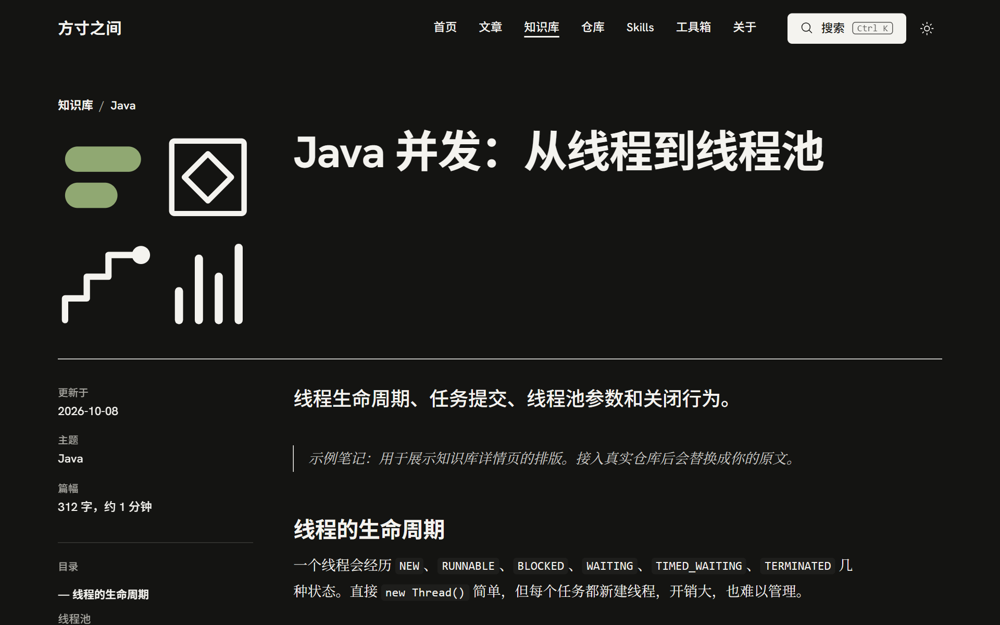

# 方寸之间

> 方寸之间见天地，细微之处有乾坤。

用 Astro 构建的中文个人博客模板，纯静态输出，部署到 Cloudflare。它面向这样一种用法：读工程博客时写解读，平时积累自己的技术笔记，顺手收藏仓库、Skills 和工具。仓库里的文章、笔记和列表都是示例内容。

| 首页（亮色） | 笔记详情（暗色） |
| --- | --- |
|  |  |

## 栏目与数据来源

文章和笔记是 Markdown 文件，有独立的详情页；仓库、Skills、工具箱是 `src/data/content.ts` 里的数组，点开后在弹窗里预览。

| 栏目 | 路径 | 内容 | 数据 |
| --- | --- | --- | --- |
| 文章 | `/posts` | 工程博客的阅读解读，每篇必须注明原文 | `src/content/posts/*.md` |
| 知识库 | `/notes` | 自己的笔记，按主题分组 | `src/content/notes/<目录>/*.md` |
| 仓库 | `/repos` | 关注的 GitHub 仓库 | `content.ts` 的 `repos` |
| Skills | `/skills` | 自己维护的 Skills | `content.ts` 的 `skills` |
| 工具箱 | `/toolbox` | 网上收藏的工具 | `content.ts` 的 `tools` |
| 归档 | `/archive` | 全部文章和笔记，`?tag=` 按标签筛选 | 自动生成 |
| 关于 | `/about` | 简介、项目、提交日历、留言墙 | `site.ts` 和 `content.ts` 的 `projects`、`guestbook` |

另有 RSS（`/rss.xml`）、Sitemap、`robots.txt` 和 404 页。

## 功能

- **阅读**：阅读时间、随滚动高亮的目录、Expressive Code 代码块（行号、折叠、复制、语言标签）、KaTeX 公式、PhotoSwipe 图片放大、标题锚点、提示框、GitHub 仓库卡片、文末版权声明。文章的声明写"原文版权归原作者所有"，笔记的声明使用 `site.ts` 里的许可协议。
- **搜索**：`Ctrl K` 打开。Pagefind 的中文分词会漏掉"线程池"这类词中间的子串，所以结果由 Pagefind 全文结果和标题、简介、标签的子串匹配合并而成。
- **视觉**：暖白配近黑的排版，标题无衬线、正文衬线，字体全部自托管。每页左侧的几何插画由页面路径决定，同一地址总是同一幅图，改了文件名插画也会变。首页和 404 页的点阵标题有飞入拼合动画，系统开启"减少动态效果"时直接显示成品。
- **深色模式**：默认跟随系统，手动切换后记在 `localStorage`。
- **分享卡片**：每篇文章和笔记在构建时生成一张 1200×630 的 PNG（`/og/<页面路径>.png`），内容是栏目、标题、简介和页面同款插画，其余页面共用 `/og/default.png`。页面头部带 Open Graph 和 Twitter Card 标签，链接发到社交平台时显示这张图。

## 快速开始

需要 Node.js 22.22 以上和 pnpm 11。`package.json` 里写了 `packageManager`，执行 `corepack enable` 后会自动用对版本。

```sh
pnpm install
pnpm dev          # http://127.0.0.1:4321
pnpm build        # 构建到 dist/，再生成 Pagefind 索引
pnpm preview      # 预览构建结果
```

Pagefind 索引只在 `pnpm build` 时生成，所以 `pnpm dev` 里的搜索只匹配标题、简介和标签，全文搜索要在 `pnpm preview` 里试。

## 用这个模板建自己的站

建议克隆后推到自己的新仓库，不要用 GitHub 的 "Use this template" 按钮。按钮生成的仓库和模板没有共同历史，以后模板的改进合并不过来；克隆的仓库可以直接 `git pull upstream main`。

```sh
git clone https://github.com/wanglei99999/fangcun-template.git my-site
cd my-site
git remote rename origin upstream
git remote add origin https://github.com/<你的账号>/<你的仓库>.git
git push -u origin main

# 以后同步模板的更新
git pull upstream main
```

然后改这几处：

| 位置 | 改什么 |
| --- | --- |
| `src/data/site.ts` | 站名、首页标语、简介、作者、GitHub 用户名、笔记的许可协议 |
| `src/content/posts/`、`src/content/notes/` | 删掉示例，放自己的文章和笔记 |
| `src/data/content.ts` | 仓库、Skills、工具箱、文章页侧栏的博客来源、关于页的项目和留言 |
| `public/` | 网站图标：`favicon.svg`、`favicon-32.png`、`apple-touch-icon.png` |
| `tests/e2e/` | 部分测试断言了示例内容的标题和篇数，换内容时一起改 |
| `wrangler.jsonc` | `name` 是 Cloudflare 上的项目名，也决定默认的 workers.dev 地址 |

内容换成真的以后，还有三处"示例"字样写在组件里：页脚的"此站为设计预览，内容均为示例"（`src/components/SiteFooter.astro`）、预览弹窗的"示例内容，阅读预览"（`src/components/Dialogs.astro`）、关于页留言墙下的说明（`src/pages/about.astro`）。

`site.ts` 的 `github` 留空时，页脚和关于页的 GitHub 链接指向 `https://github.com/`，关于页按钮显示"GitHub 账号待填写"。

## 写作

```sh
pnpm new-post agent-memory "标题"          # 新建 src/content/posts/agent-memory.md
pnpm new-note java/thread-local "标题"     # 新建 src/content/notes/java/thread-local.md
```

脚本生成完整的 frontmatter，文件名只能用小写字母、数字和连字符。新文件是 `draft: true`：`pnpm dev` 里能看到，`pnpm build` 不会发布，写完改成 `false`。

### Frontmatter

字段由 `src/content.config.ts` 校验，缺字段或格式不对时构建直接报错。

文章：

```yaml
title: 比提示词更重要的，是上下文
description: 列表和搜索结果里显示的一句话简介
published: 2026-10-12
updated: 2026-10-15          # 可选
blog: Anthropic              # 来源简称，文章列表按它筛选
source:
  name: Anthropic Engineering
  url: https://www.anthropic.com/engineering
tags: [Claude, Agent]
draft: false
```

笔记：

```yaml
title: Java 并发：从线程到线程池
description: 线程生命周期、任务提交、线程池参数和关闭行为。
topic: Java                  # 知识库按它分组显示
updated: 2026-10-08
tags: [Java, 并发]
draft: false
```

笔记的地址由目录决定（`notes/java/concurrency.md` 对应 `/notes/java/concurrency`），分组名由 `topic` 决定，两者可以不同。`pnpm new-note` 会沿用同目录下已有笔记的 `topic`，目录是新建的时候用目录名。

同一主题的笔记在知识库页和"上一篇 / 下一篇"里按文件名排序，数字按数值比较，所以系列笔记用 `01-`、`02-` 开头就会按顺序排。首页只显示最近更新的几篇。

图片和 Markdown 文件放在一起，用相对路径引用，构建时由 Astro 打包，位图会被压缩。

### 导入已有笔记

笔记原本写在别处（Obsidian 库、另一个仓库）时，用导入命令复制进来：

```sh
pnpm import-notes ../learn_note/Agent agent              # 导入目录下的 .md，放进 src/content/notes/agent/
pnpm import-notes ../learn_note/Agent agent --topic "Agent 原理" --publish
pnpm import-notes ../learn_note/Agent agent --force      # 源文件改过之后重新导入
```

源笔记不需要 frontmatter，命令按下面的规则生成：

| 字段或内容 | 来源 |
| --- | --- |
| `title` | 正文第一个 `# 标题`，从正文里移走（页面会单独显示标题） |
| `description` | 第一段。150 字以内且没有链接、公式、代码时整段移到这里，作为页面导语；否则取第一句，正文不动 |
| `updated` | 源文件在 git 里最后一次提交的日期，取不到时用标题下的"创建日期：YYYY-MM-DD"行 |
| `topic` | `--topic` 的值，默认是源目录名 |
| `origin` | 源文件在它所在仓库里的路径，用来在多次导入之间解析链接 |
| 图片和附件 | 复制到目标目录，保持相对路径 |
| 指向其他笔记的 `.md` 链接 | 目标也导入过的，改成站内地址；没导入的，改成源仓库在 GitHub 上的地址 |

导入目录时跳过 `README.md` 和 `CLAUDE.md`，不进入子目录。不想发布的笔记写进站点根目录的 `.importignore`，一行一个源路径（相对源仓库根目录，如 `Agent/13-拆解一个真实的harness.md`，`#` 开头为注释）；被忽略的笔记不会导入，别的笔记链到它时链接指向源仓库。代码块和行内代码里的链接保持原样。新导入的笔记是草稿，加 `--publish` 直接发布。目标文件已存在时默认跳过；加 `--force` 会用源文件覆盖正文，但保留网站这边已经改过的 frontmatter，只刷新 `updated`。Obsidian 的 `[[双链]]` 不会转换，命令会列出含有双链的文件。

自动生成的 `description` 常常是"上一篇……"这样的承接句，放在列表里读不出这篇讲什么，发布前最好逐篇改写。

### Markdown 扩展

```md
:::tip[可选标题]
提示框，类型有 note / tip / important / warning / caution。
:::

> [!WARNING]
> GitHub 风格的写法同样支持。

::github{repo="owner/name"}

行内公式 $E = mc^2$，行间公式：

$$
\text{MRR} = \frac{1}{|Q|} \sum_{i=1}^{|Q|} \frac{1}{\text{rank}_i}
$$


```

GitHub 卡片在浏览器里请求 GitHub API，结果在 `sessionStorage` 里缓存一小时；接口不通时卡片退化成普通链接。

代码块默认带行号，命令行、纯文本和 Markdown 除外。`collapse` 指定默认折叠的行：

````md
```python title="hybrid.py" collapse={1-5}
# 第 1–5 行默认折叠
```
````

## 部署到 Cloudflare

仓库自带 `wrangler.jsonc`，按 Workers 静态资源的方式部署：`dist/` 整个作为静态文件上传，不存在的路径返回 `dist/404.html` 和 404 状态码，`/notes/java/concurrency` 会 307 跳转到带斜杠的地址。Node 版本由 `.node-version` 指定为 24。

在 Cloudflare 控制台 Workers & Pages → Create application → Import a repository，选中仓库后这样填：

| 设置 | 值 |
| --- | --- |
| Project name | 和 `wrangler.jsonc` 的 `name` 一致，默认地址是 `<name>.<账号子域名>.workers.dev` |
| Build command | `pnpm build` |
| Deploy command | `npx wrangler deploy`（默认值） |
| Build variables | `PNPM_VERSION=11.28.6`，`SITE_URL=https://你的地址` |

构建镜像默认的 pnpm 是 10.x，所以要用 `PNPM_VERSION` 指定 11。`SITE_URL` 不设时默认是 `https://notes.example.com`，RSS、Sitemap 和 canonical 链接都会指错地址；第一次部署拿到 workers.dev 地址后填进去，再重新部署一次。

部署前可以在本地验证配置：`pnpm build` 之后运行 `npx wrangler dev`，在 `http://localhost:8787` 看到的就是线上的路由行为。`*.workers.dev` 在国内访问不稳定，最好绑定自己的域名（项目的 Settings → Domains & Routes）。

用 Cloudflare Pages 部署也可以：构建命令 `pnpm build`，输出目录 `dist`，同样设置上面两个变量。Pages 会自动把 `404.html` 当作 404 页。

## 测试

```sh
pnpm test         # 构建后运行全部端到端测试
pnpm test:e2e     # 已经构建过时只跑测试
```

测试用 Playwright，会自己启动 `astro preview`（端口 4322），覆盖首页、详情页、归档筛选、搜索、点阵标题动画等。第一次运行前执行 `pnpm exec playwright install chromium` 下载浏览器，或者设置 `PW_CHANNEL=msedge`（或 `chrome`）用本机已装的浏览器。

## 维护时要知道的事

- `pnpm build` 带 `--force`。不带的话，Astro 的 Content Layer 缓存会让代码块的样式文件（`ec.*.css`）在新构建里 404。
- Astro 7 默认的 Markdown 处理器是 Sätteri。这里在 `astro.config.mjs` 里换回了 unified（remark/rehype），因为提示框、公式、GitHub 卡片这些插件都基于它。
- `remark-github-admonitions-to-directives` v2 默认把 IMPORTANT、CAUTION 改名成 info、danger，配置里显式映射回了 GitHub 的原名。
- 分享卡片由 `src/utils/og.ts` 生成：satori 排版成 SVG，resvg 转成 PNG。satori 读不了 woff2 和 oklch，所以字体用 fontsource 包里的 `.woff`，只加载卡片文字用到的 Noto Sans SC 子集；颜色是 `global.css` 亮色变量换算出的十六进制值，改配色时两边一起改。
- Markdown 插件在 `src/plugins/`，浏览器端脚本（搜索、点阵标题、图片放大、GitHub 卡片）在 `src/scripts/`，插画生成在 `src/utils/glyph.ts`。

## 已知限制

- 关于页的 GitHub 提交日历是占位数据。
- 留言墙和点子收集箱只有界面，表单处于禁用状态，要接入后端（比如 Cloudflare D1）才能用。

## 许可与致谢

代码以 [MIT 许可](./LICENSE) 发布。`src/content/` 里的文章按各篇文末声明的协议授权。

文章阅读相关的功能参考并移植自 [Fuwari](https://github.com/saicaca/fuwari)（MIT 许可，© saicaca），包括阅读时间插件、提示框与指令插件、GitHub 卡片结构、目录高亮思路、RSS 和 robots 端点、Expressive Code 的语言标签、行号和折叠配置、Pagefind、KaTeX 与 PhotoSwipe 的配置、文末版权声明和新建文章脚本。版式参考了 Anthropic 官网与工程博客的排版体系，没有使用其名称、Logo、专有字体或插画。
