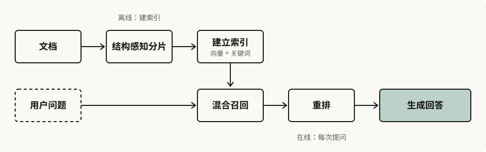

> 示例笔记。

## 整体流程



## 分片

按固定长度切分最简单，但容易把一个完整的段落切断。按文档结构（标题、段落）切分，召回的片段更完整。

## 混合检索

向量检索擅长语义相近，关键词检索擅长精确匹配，两者结合再重排：

```python title="hybrid.py" collapse={1-5}
from dataclasses import dataclass

from .embedding import embed
from .rerank import rerank
from .stores import keyword_index, vector_store


def hybrid_search(query: str, k: int = 10) -> list[Chunk]:
    dense = vector_store.search(embed(query), k=k * 2)
    sparse = keyword_index.search(query, k=k * 2)
    return rerank(query, merge(dense, sparse))[:k]
```

## 评估

召回率衡量该找到的片段找到了多少，第 $k$ 位以内的召回率记作 $\text{Recall@}k$：

$$
\text{Recall@}k = \frac{|\,\text{相关片段} \cap \text{前 } k \text{ 个结果}\,|}{|\,\text{相关片段}\,|}
$$

MRR 看第一个相关结果排在第几位，对所有问题 $Q$ 取平均：

$$
\text{MRR} = \frac{1}{|Q|} \sum_{i=1}^{|Q|} \frac{1}{\text{rank}_i}
$$
